<div align="center">

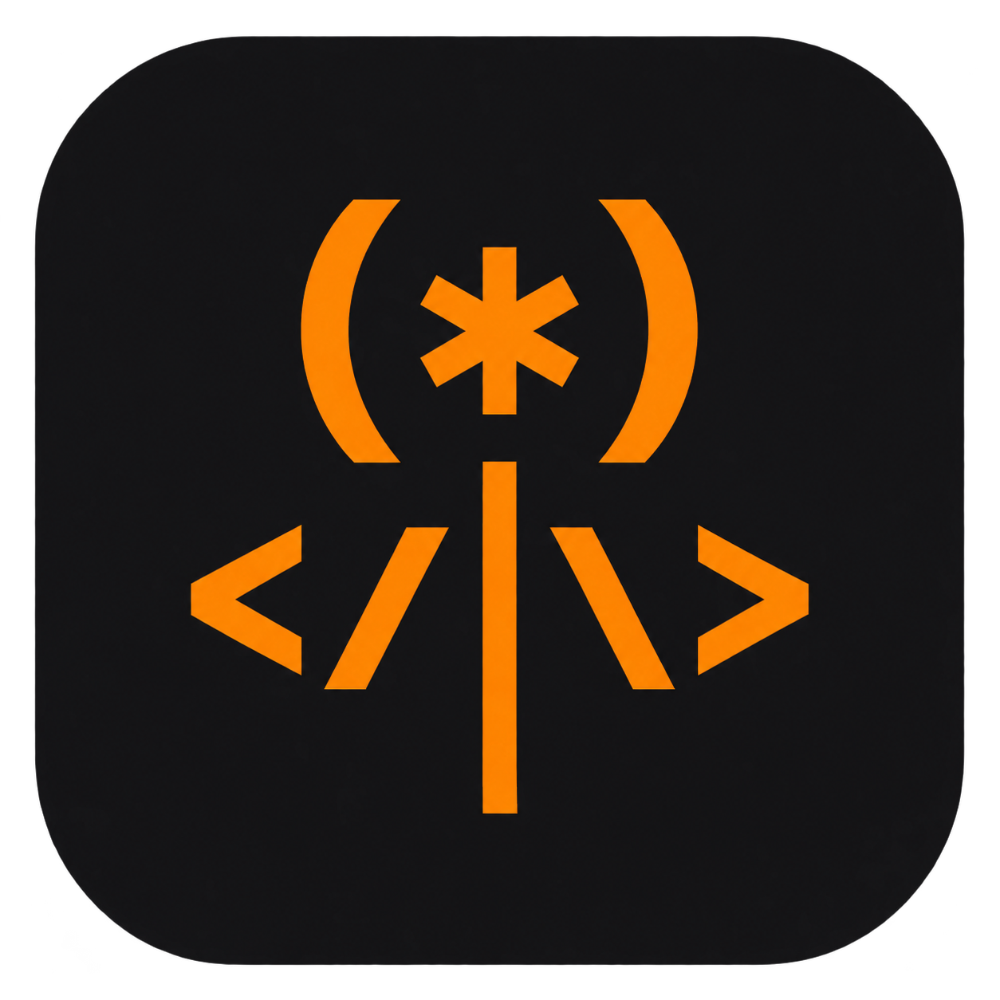

# Twayblade

**A native Matrix client for macOS, Linux and Windows, written in Rust.**

[Download](../../releases) · [Roadmap](PLAN.md) · [Development](DEVELOPMENT.md)

</div>

## Screenshots

<p align="center">
  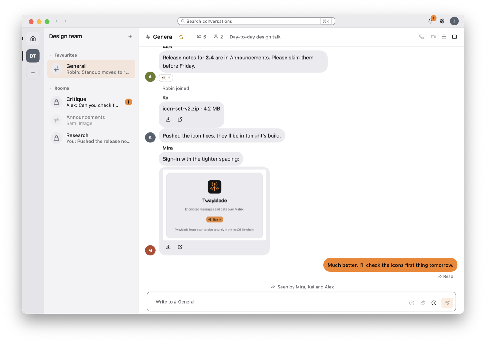
</p>

<table>
  <tr>
    <td width="50%">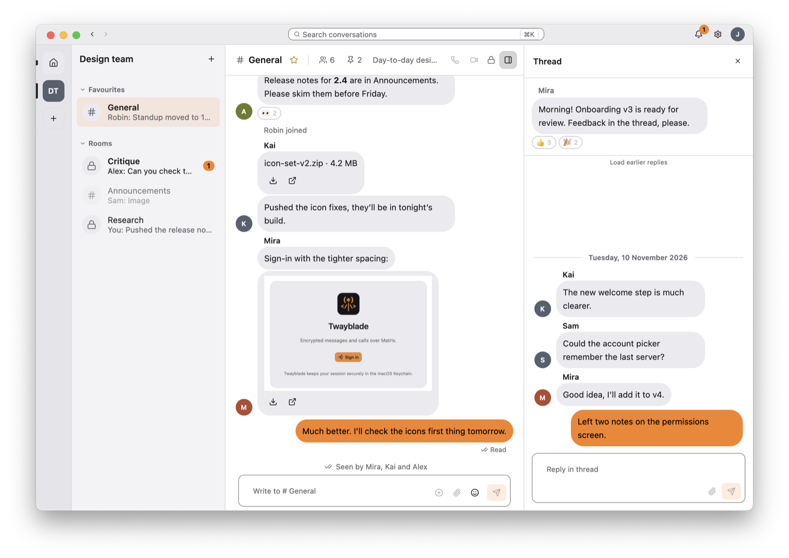<br>Threads</td>
    <td width="50%">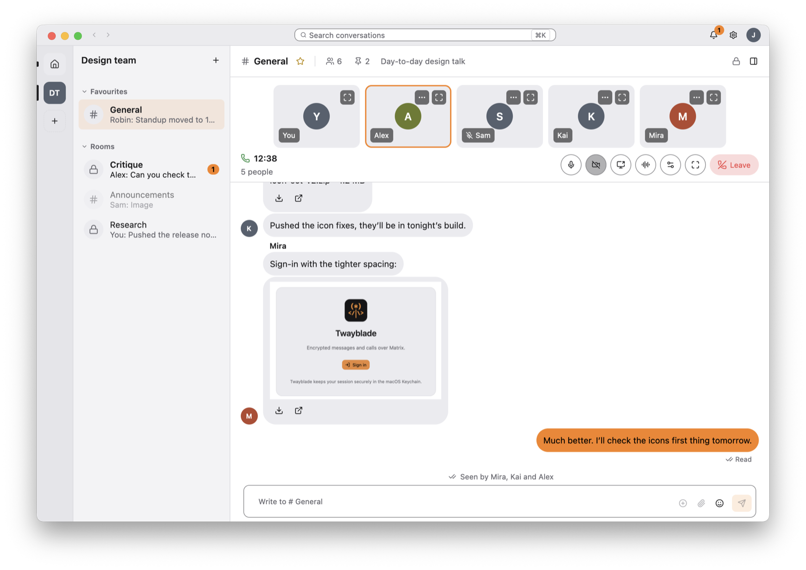<br>Group calls</td>
  </tr>
  <tr>
    <td>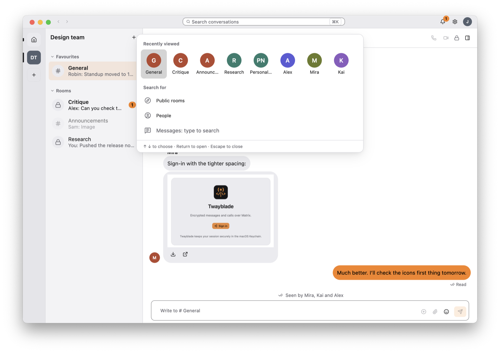<br>Search</td>
    <td>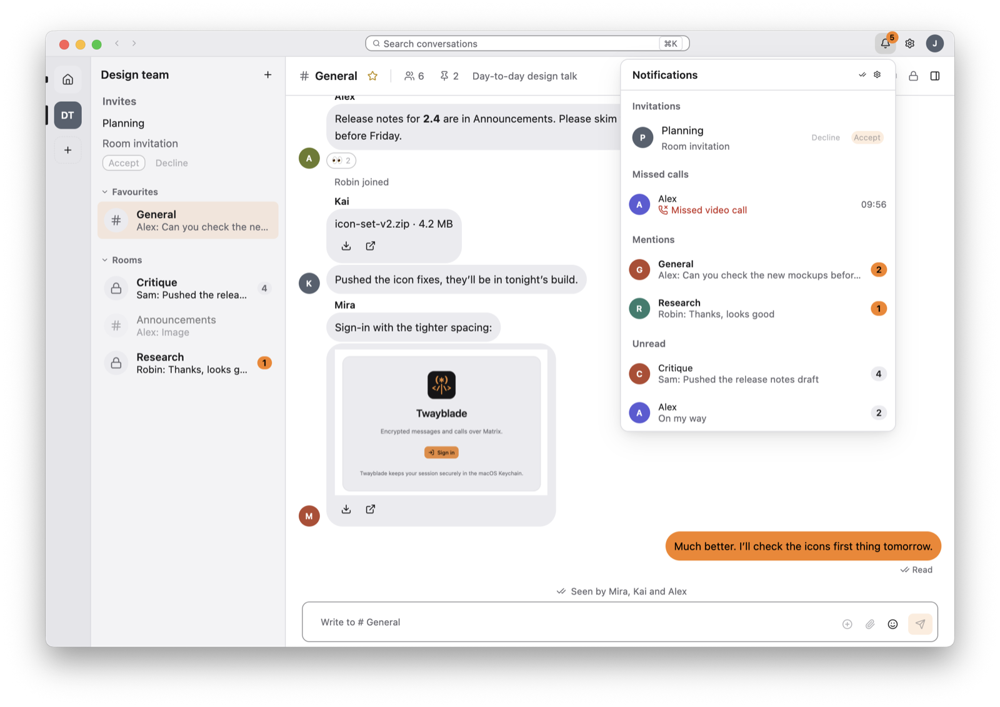<br>Notifications</td>
  </tr>
  <tr>
    <td>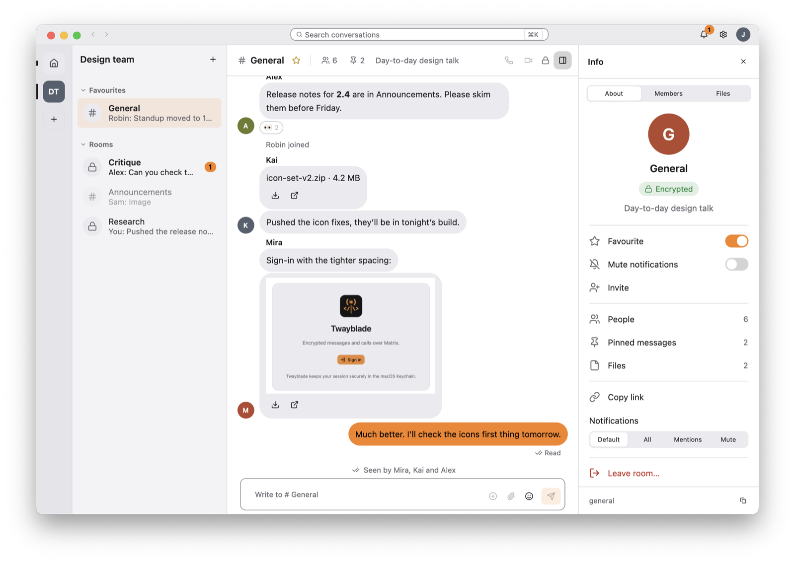<br>Room details</td>
    <td>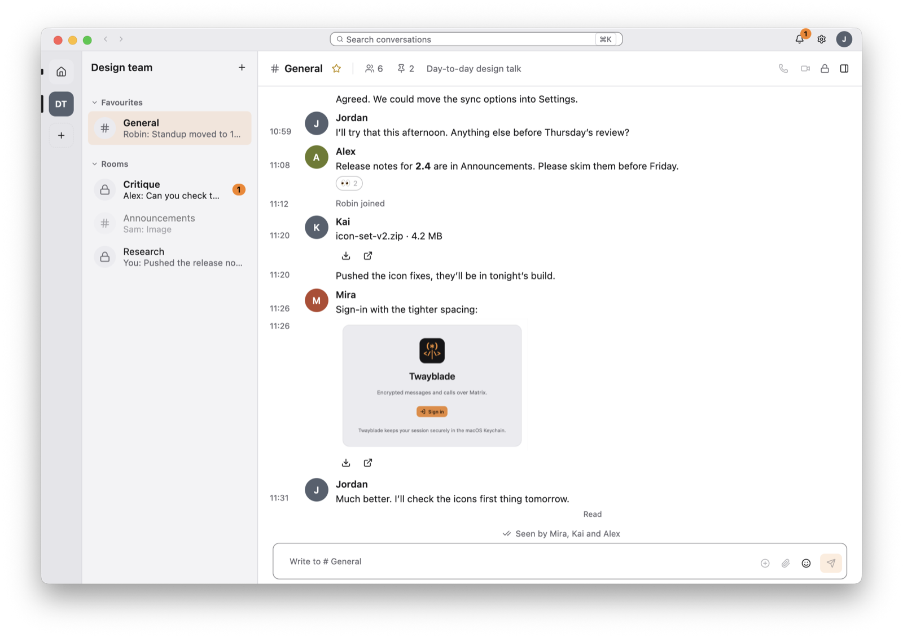<br>Minimal chat style</td>
  </tr>
  <tr>
    <td>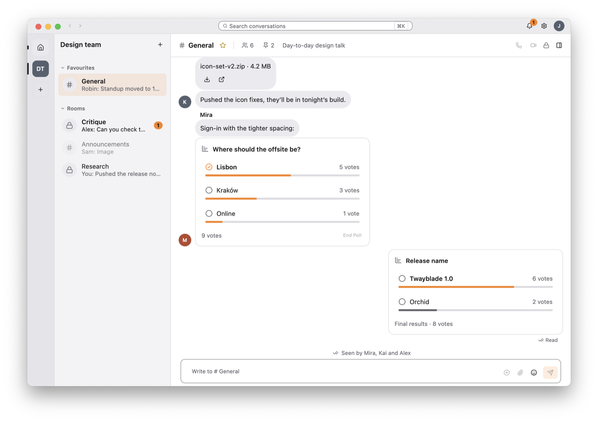<br>Polls</td>
    <td>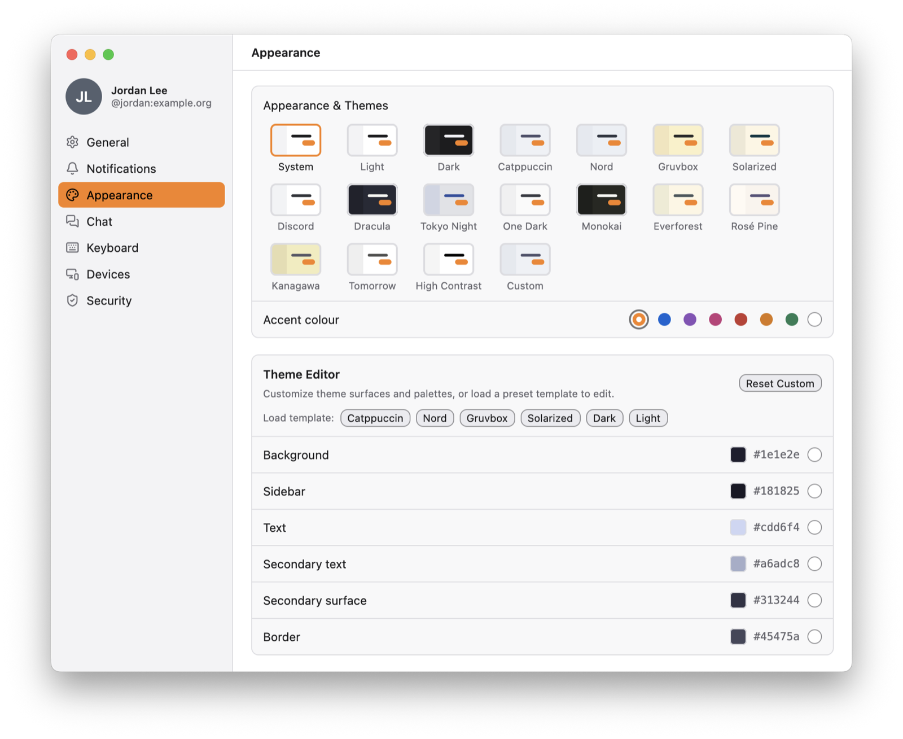<br>Themes</td>
  </tr>
  <tr>
    <td>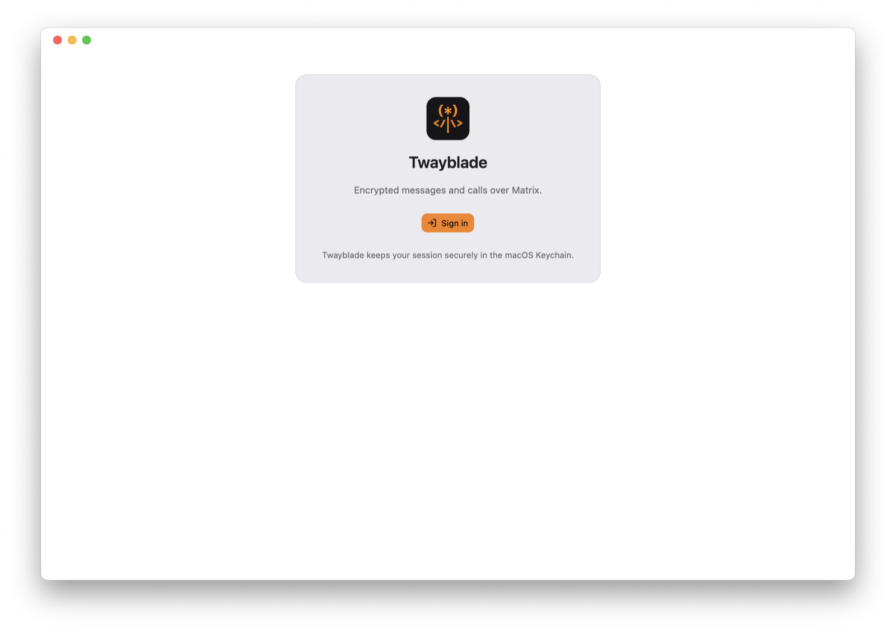<br>Welcome</td>
    <td>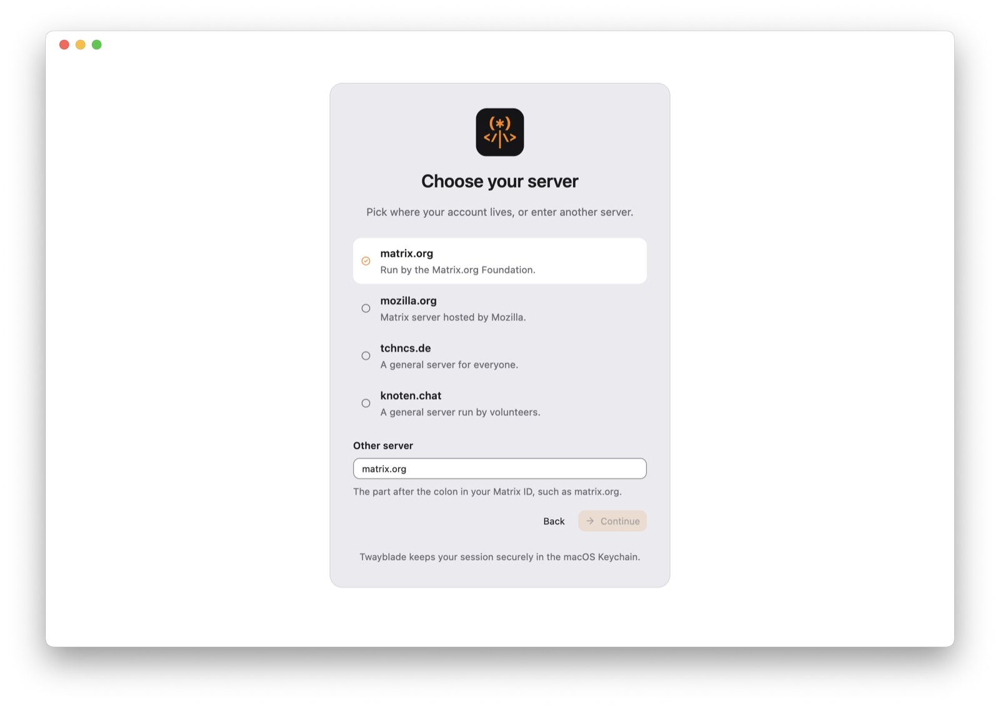<br>Choosing a server</td>
  </tr>
</table>

Taken on macOS from the app's offline preview (`--preview-showcase`), which
shows sample people and messages rather than a real account.

## Features

- **End-to-end encryption** with device verification by emoji, secure backup
  and recovery keys
- **Sign in** with a password, OAuth or single sign-on, with **several
  accounts** side by side; sessions are kept in your system keychain
- **Spaces, rooms and direct messages**, with favourites, an archive,
  invitations and a list of the latest message under each conversation
- **Explore public rooms** on your own server or on matrix.org, mozilla.org,
  gnome.org and kde.org
- **Conversations** with threads, quoted replies, reactions, `@` mentions,
  editing and deleting, read status and typing indicators
- **Formatting**: bold, italic, code, links, quotes and lists from the
  keyboard, the right-click menu or the bar over selected text
- **Images and files**: attach, paste or drop them; browse a room's media and
  open pictures full size
- **Voice and video calls** on MatrixRTC (end-to-end encrypted, works with
  Element Call), with screen sharing
- **Search** like Spotlight: recent conversations, people, public rooms and
  messages, with a filter by sender
- **Notifications** that follow your Matrix settings, plus an activity list
  with missed calls and Mark All as Read
- **Presence and status messages**
- **Offline reading**: saved conversations stay available without a
  connection
- **Your look**: themes, accent colours, scaling, sidebar density and three
  chat styles (Bubbles, IRC, Minimal)
- **Updates** from inside the app, with checksum-verified downloads

## Install

Download the latest release from [Releases](../../releases).

| System | Package | How to install |
|---|---|---|
| macOS (Apple silicon) | `Twayblade-…-arm64.dmg` | Open the DMG and drag Twayblade to Applications |
| macOS with Homebrew | — | `brew install --cask zerw0/twayblade/twayblade` |
| Windows (x86_64) | `Twayblade-…-x86_64.msi` | Run the installer |
| Debian, Ubuntu | `twayblade_…_amd64.deb` | `sudo apt install ./twayblade_*_amd64.deb` |
| Fedora, openSUSE | `twayblade-….x86_64.rpm` | `sudo dnf install ./twayblade-*.x86_64.rpm` |
| Any Linux | `Twayblade-…-x86_64.AppImage` | `chmod +x Twayblade-*.AppImage`, then run it |

The builds are not signed with a paid certificate, so the first launch needs
one extra step:

- **macOS:** open Twayblade, close the warning, then choose **Open Anyway** in
  **System Settings › Privacy & Security**.
- **Windows:** when SmartScreen says "Windows protected your PC", choose
  **More info › Run anyway**.
- **Linux:** signing in needs a Secret Service keychain such as GNOME Keyring
  or KWallet.

Your homeserver needs native sliding sync, as in current Synapse releases.

## Build from source

Requires [Rust](https://rustup.rs) 1.99 or newer.

```sh
git clone https://github.com/zerw0/twayblade.git
cd twayblade
cargo run --release -p twayblade
```

Try the interface with sample data, without an account:

```sh
cargo run -p twayblade -- --preview
```

## License

Twayblade is licensed under the [MIT License](LICENSE). Third-party dependencies
retain their own licenses.
