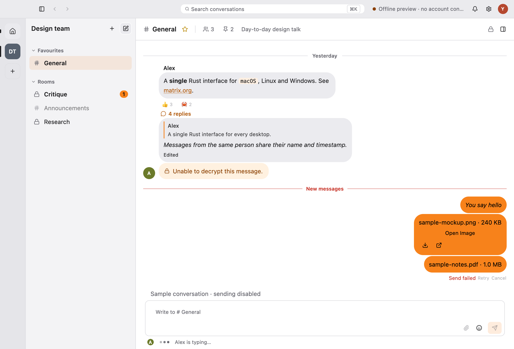
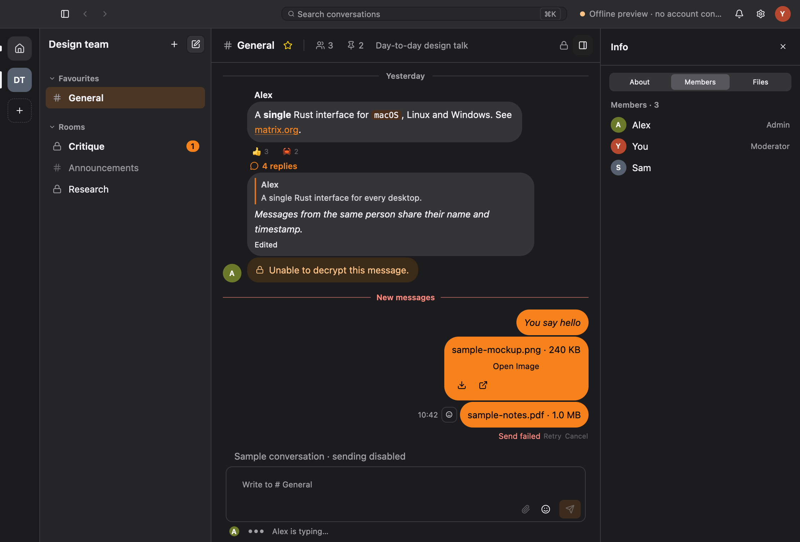

<div align="center">

# Twayblade

**A native Matrix client for macOS, Linux and Windows, written in Rust.**

[Download](../../releases) · [Roadmap](PLAN.md) · [Development](DEVELOPMENT.md)

</div>

> [!NOTE]
> Twayblade is in early development and not ready for daily use yet.
> Try it with a test account.

<table>
  <tr>
    <td></td>
    <td></td>
  </tr>
</table>
<p align="center"><sub>Screenshots from the built-in offline preview, which uses sample data.</sub></p>

## Features

- **End-to-end encryption** with device verification, secure backup and recovery
- **Sign in** with a password, OAuth or single sign-on; sessions live in your OS keychain
- **Spaces, rooms and direct messages**, with favourites and invites
- **Threads, replies, reactions**, formatted messages, images and files
- **Search** across conversations and messages
- **Native notifications** that follow your Matrix settings
- **Themes, scaling and chat styles**: Bubbles, IRC or Minimal

Coming next: voice and video calls, and a public room directory.

## Install

Grab the latest build from [Releases](../../releases).

Builds are not signed yet. On macOS, right-click **Twayblade.app** › **Open** the
first time; on Windows, choose **More info** › **Run anyway**.

Your homeserver needs native sliding sync, as in current Synapse releases.

## Build from source

Requires [Rust](https://rustup.rs) 1.99 or newer.

```sh
git clone https://github.com/zerw0/twayblade.git
cd twayblade
cargo run --release -p twayblade
```

Explore the interface without an account:

```sh
cargo run -p twayblade -- --preview
```

## License

Twayblade is licensed under the [MIT License](LICENSE). Third-party dependencies
retain their own licenses.
